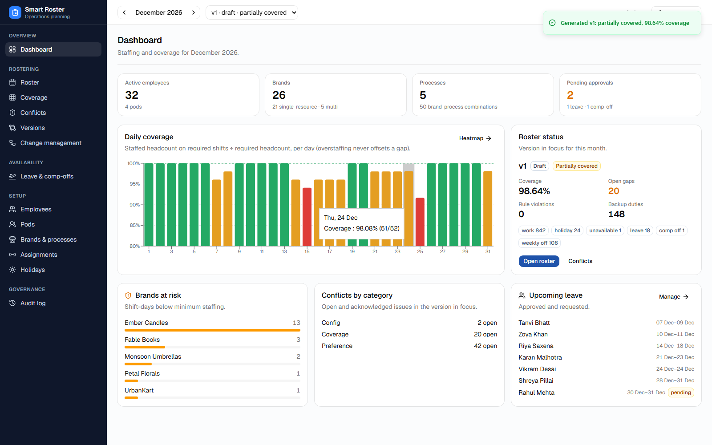
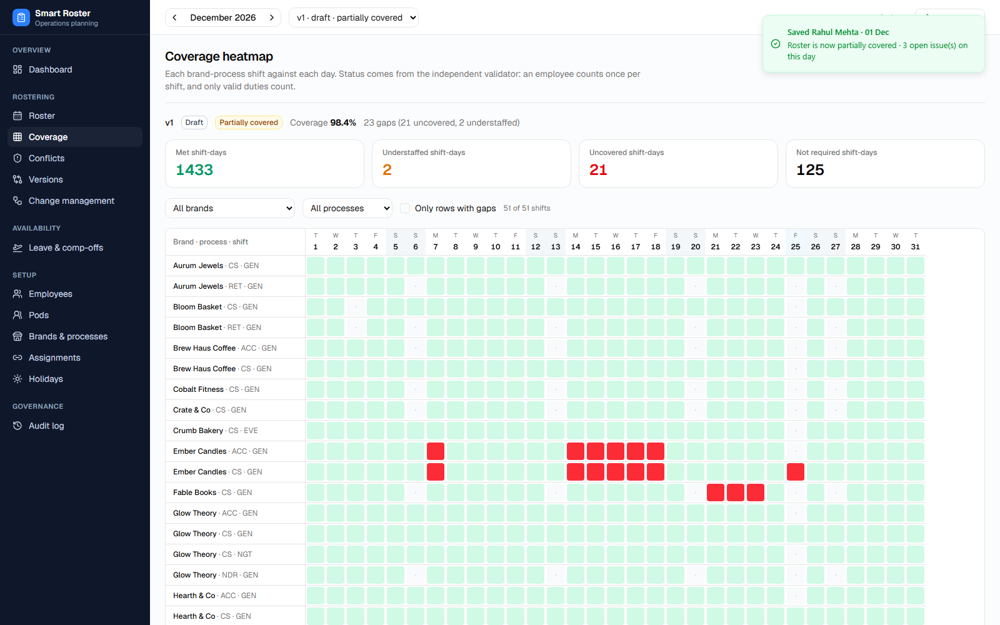
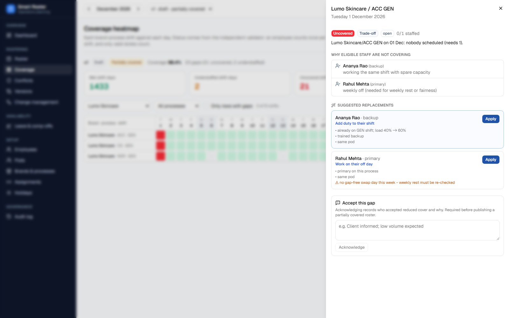
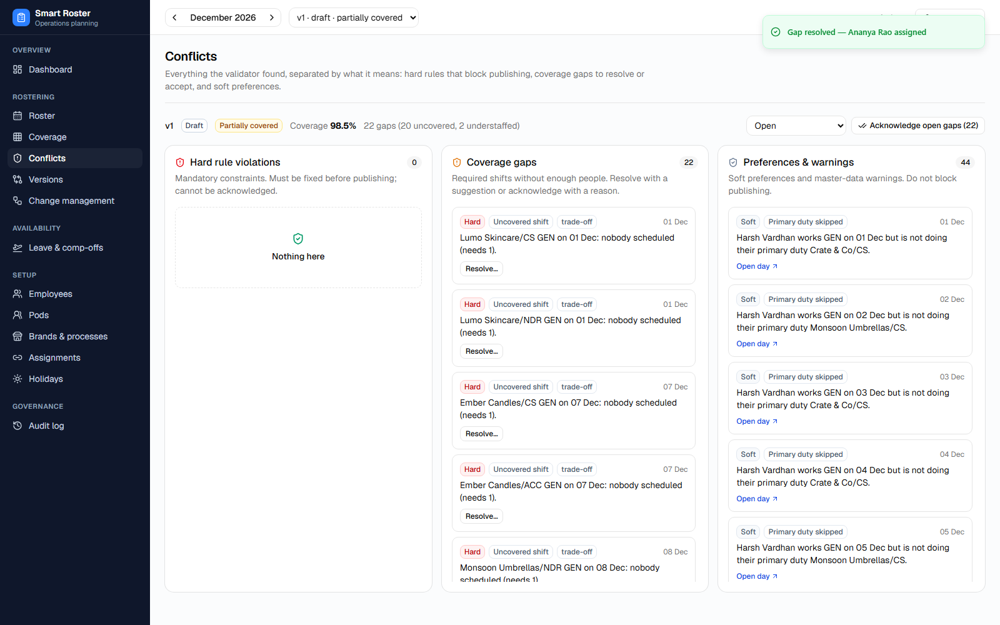
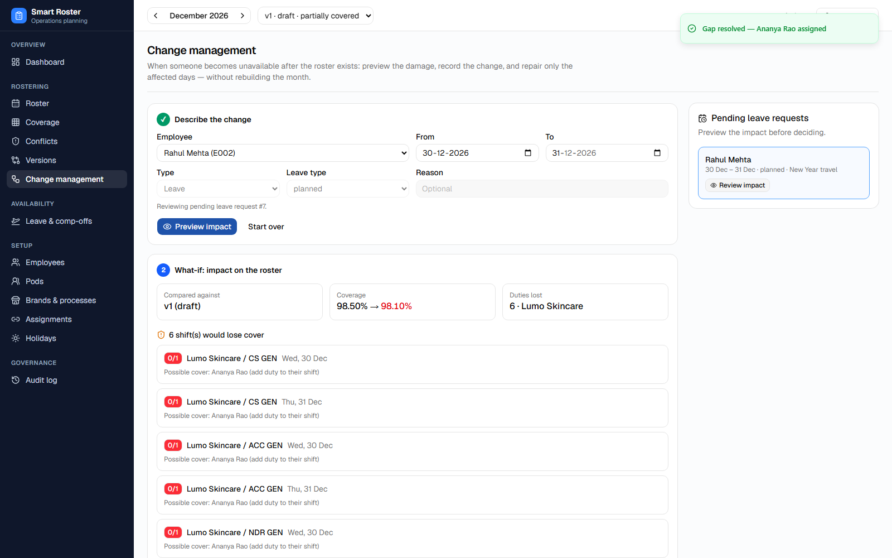
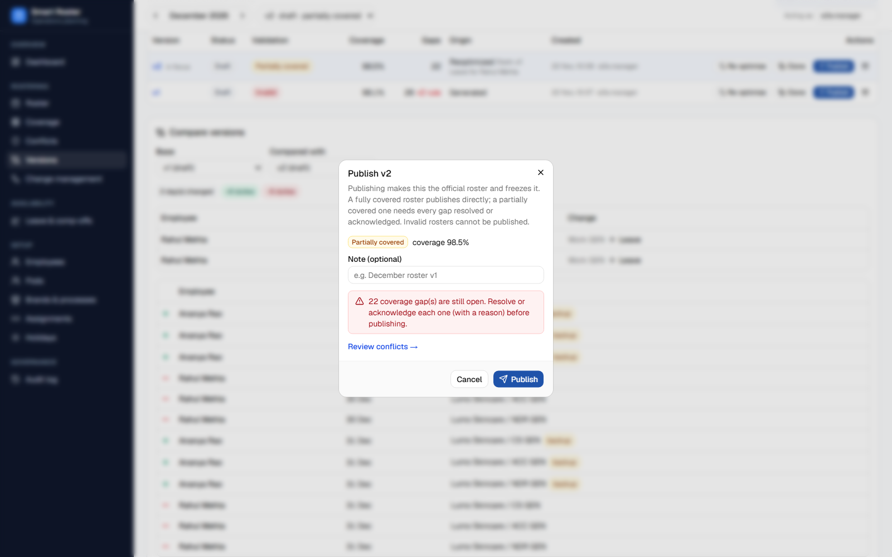

# Smart Roster Management System

A roster planner for a multi-brand customer-operations team. It generates monthly rosters with a constraint solver (Google OR-Tools CP-SAT), validates them independently, explains every coverage gap, and re-plans only the affected window when something changes.

> **Status:** Phases 0–4 are complete: scheduling engine, validator, REST API and a full browser UI (roster grid, coverage heatmap, conflicts, versions, change management, availability, setup screens and audit log), verified by an end-to-end browser test against the real backend. See [docs/ARCHITECTURE.md](docs/ARCHITECTURE.md) for the design and progress, and [docs/ASSUMPTIONS.md](docs/ASSUMPTIONS.md) for assumptions and the sample dataset.

## Stack

* **Backend:** Python 3.13, FastAPI, SQLAlchemy 2, Alembic, Pydantic v2, OR-Tools CP-SAT
* **Database:** PostgreSQL (tested on 18; uses `btree_gist`, JSONB, partial indexes, a PL/pgSQL trigger)
* **Frontend:** React 19, TypeScript, Vite, Tailwind CSS 4, shadcn/ui, TanStack Query, Recharts, Playwright (E2E)

## Deployment

The app deploys as Vercel (frontend) → Render (API) → Neon (PostgreSQL), all on free tiers. See [docs/DEPLOYMENT.md](docs/DEPLOYMENT.md) for the provider comparison and limits, environment variables, step-by-step setup and the verification checklist.

## Local setup

### Backend

```bash
cd backend
python -m venv .venv
.venv/Scripts/activate            # Windows  (source .venv/bin/activate on macOS/Linux)
pip install -r requirements.txt
cp .env.example .env              # then set DATABASE_URL
createdb smart_roster             # or: psql -c "create database smart_roster"
alembic upgrade head              # schema, constraints, trigger
python -m app.cli seed            # sample dataset (32 employees, 26 brands)
python -m app.cli generate --month 2026-12 --save
uvicorn app.main:app --reload     # API docs: http://localhost:8000/docs
```

Example output of `generate` for the seed data:

```
Status: PARTIALLY_COVERED
Solver: OPTIMAL  in ~1s  candidates=2758
Coverage: 98.64%  gaps=20  hard rule violations=0
  [UNAVOIDABLE] Ember Candles/CS GEN on 14 Dec: nobody scheduled (needs 1).
      - Riya Saxena (primary): on approved leave
  ...
```

Every remaining gap in the seed month is a deliberate scenario, documented in `docs/ASSUMPTIONS.md`.

### Tests

```bash
cd backend
pytest tests/engine                       # 42 engine tests, no database needed (~5 s)
TEST_DATABASE_URL=postgresql+psycopg://user:pw@localhost:5432/smart_roster_test pytest   # all 78 (engine + DB + API)
```

The DB tests rebuild the schema from migrations in a database whose name **must end in `_test`**. They then seed it and check what PostgreSQL itself guarantees:
- composite foreign keys,
- duties can only exist on WORK entries,
- the overlap exclusion,
- the eligibility trigger,
- no double counting,
- a single published version per month.

### Change workflow through the API (PDF section F)

```text
POST /api/impact-preview            {employee_id, date_from, date_to}   -> gaps that would open + ranked cover
POST /api/leaves/{id}/approve                                           -> stale versions + reoptimize_hint
GET  /api/versions/{id}                                                 -> re-validated (gaps now have suggestions)
POST /api/versions/{id}/reoptimize  {...reoptimize_hint}                -> new draft, only that window changed, diff
POST /api/conflicts/{id}/apply-suggestion | /acknowledge               -> fix or accept individual gaps
POST /api/versions/{id}/publish                                         -> needs no open gaps / rule violations
```

With the seed data, approving Rahul Mehta's requested leave (30–31 Dec) makes the draft `INVALID`, because he is rostered on those days. Re-optimising that window changes 2 entries and activates his trained backup, Ananya Rao, for all three Lumo processes. Coverage returns to 98.64%.

### Frontend

```bash
cd frontend
npm install
npm run dev                       # http://localhost:5173 (proxies /api to 127.0.0.1:8000)
npm run e2e                       # full browser journey against the running, freshly seeded backend
```

## Screens

| | |
|---|---|
|  |  |
| **Dashboard**: staffing, daily coverage, brands at risk, upcoming leave | **Roster grid**: employees × days with shifts, duties, backup and manual markers, plus coverage rows |
|  |  |
| **Coverage heatmap**: MET / UNDERSTAFFED / UNCOVERED / NOT_REQUIRED per shift-day | **Gap panel**: why each eligible person is not covering, plus ranked replacements to apply |
|  |  |
| **Conflicts**: hard rule violations, coverage gaps and soft preferences kept separate | **Change management**: what-if impact of a leave before approving it |
|  |  |
| **Re-optimise window**: only the affected days change; diff of the new draft | **Publish guard**: a 409 while gaps are unacknowledged |

All 22 screenshots, including availability, comp-offs, setup screens, audit log and mobile, are in [docs/screenshots](docs/screenshots). They are produced by the E2E test.

## Repository layout

```
backend/
  app/scheduling/     pure scheduling engine (solver, validator, re-optimiser, suggestions)
  app/models/         SQLAlchemy models
  app/api/            REST routers and error mapping
  app/services/       versioning, edits, publish, comp-offs, staleness, audit, dashboard
  app/seed/           sample dataset (+ editable holidays.json)
  alembic/            migrations
  tests/engine, tests/db, tests/api
frontend/             React app (src/pages, src/components/roster, e2e/)
docs/                 architecture and assumptions
```

## Tell us how you think

The answers to the assessment's eight questions will be added here in Phase 7, once the API and UI are complete.
